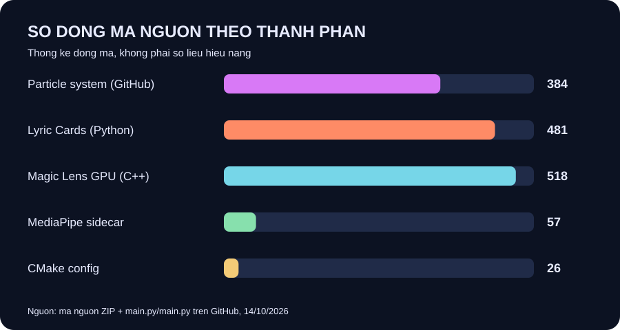
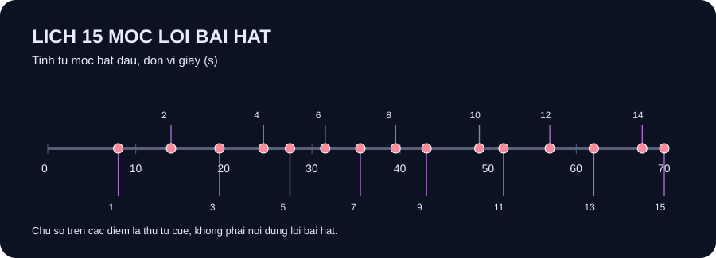
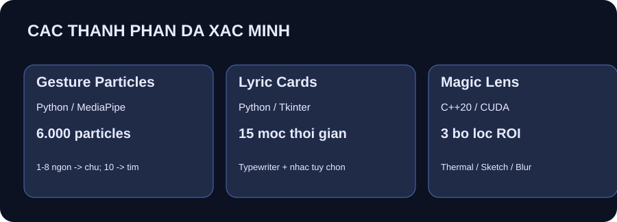
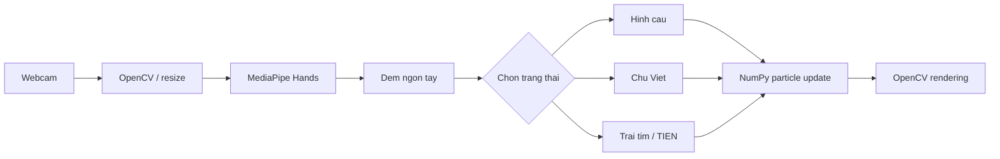
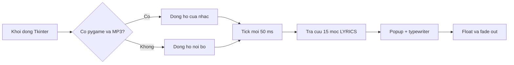
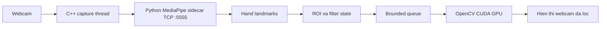

# CodeChayChu — Hieu ung hat, lyric popup va Magic Lens

<p align="center">
  
  
  
  
  
</p>

> **Ba thí nghiệm độc lập**, không phải một ứng dụng web hay một hệ thống đã tích hợp hoàn toàn. README này tổng hợp **mã nguồn đã có trên GitHub** và **mã nguồn trong file ZIP `lyric bai hat.zip`**, giữ tách riêng để không làm hỏng chương trình hiện có.

**Repository:** [luu246luu-del/codechaychu](https://github.com/luu246luu-del/codechaychu)
**Ứng dụng:** chạy trên máy có môi trường Python/OpenCV; bản GPU dùng Linux, OpenCV CUDA và card NVIDIA tương thích.
**Tình trạng kiểm chứng:** kiểm tra cấu trúc và cú pháp Python; **chưa đo FPS thực tế**, chưa xác nhận hoạt động webcam/GPU trên phần cứng đích.

## Mục lục

1. [Tổng quan ba chương trình](#1-tổng-quan-ba-chương-trình)
2. [Thống kê mã nguồn và biểu đồ](#2-thống-kê-mã-nguồn-và-biểu-đồ)
3. [Dự án A — Particle Gesture](#3-dự-án-a--particle-gesture)
4. [Dự án B — Lyric Cards](#4-dự-án-b--lyric-cards)
5. [Dự án C — Magic Lens GPU](#5-dự-án-c--magic-lens-gpu)
6. [Kiến trúc và luồng xử lý](#6-kiến-trúc-và-luồng-xử-lý)
7. [Cấu trúc repository](#7-cấu-trúc-repository)
8. [Yêu cầu và cách chạy](#8-yêu-cầu-và-cách-chạy)
9. [Cấu hình và tùy biến](#9-cấu-hình-và-tùy-biến)
10. [Kiểm thử, giới hạn và bảo mật](#10-kiểm-thử-giới-hạn-và-bảo-mật)
11. [Nguồn số liệu](#11-nguồn-số-liệu)

---

## 1. Tổng quan ba chương trình

| Thành phần | Công nghệ | Chức năng | Điểm chạy |
|---|---|---|---|
| **Particle Gesture (bản GitHub)** | Python, OpenCV, MediaPipe, NumPy, Pillow | Tạo đám hạt chuyển thành chữ, trái tim theo số ngón tay trước webcam | [`main.py/main.py`](main.py/main.py) |
| **Lyric Cards (từ ZIP tải lên)** | Python, Tkinter; pygame tùy chọn | Popup lời bài hát với hiệu ứng hiện/ẩn, đánh chữ, trôi và đồng bộ mốc thời gian | [`lyric_cards/lyric_cards_fixed.py`](lyric_cards/lyric_cards_fixed.py) |
| **Magic Lens (ZIP lồng bên trong)** | C++20, OpenCV CUDA, Python MediaPipe sidecar | Thay đổi filter trên vùng ROI bằng chuyển động hai bàn tay | [`experiments/magic_lens/main.cpp`](experiments/magic_lens/main.cpp) |

**Quan trọng:** Không dùng GitHub Pages để chạy những ứng dụng desktop này. Website GitHub Pages chỉ phục vụ nội dung tĩnh, không chạy trực tiếp Python desktop hoặc C++ CUDA.

## 2. Thống kê mã nguồn và biểu đồ

### 2.1 Số liệu kiểm chứng được

| Chỉ số | Giá trị | Nguồn |
|---|---:|---|
| Hạt hiển thị mặc định (Particle Gesture) | **6.000** | `NUM_PARTICLES` trên GitHub |
| Kích thước khung hiển thị Particle Gesture | **1280 × 720** | `WIDTH`, `HEIGHT` |
| Kích thước đầu vào nhận diện bàn tay | **480 × 270** | `DETECT_WIDTH`, `DETECT_HEIGHT` |
| Số ánh xạ cử chỉ thành đoạn chữ | **8** | `GESTURE_LETTER_TEXT` (1–8 ngón) |
| Mốc thời gian lời bài hát | **15** | `LYRICS` trong Lyric Cards |
| Mốc đầu / cuối của lyric | **8,0 / 70,0 giây** | `LYRICS[*].time` |
| Kích thước popup lời bài hát | **270 × 270 px** | `WINDOW_SIZE` |
| Bộ lọc của Magic Lens | **3** | `THERMAL`, `SKETCH`, `BLUR` |
| Số điểm mốc mỗi bàn tay của Magic Lens | **21** | dữ liệu MediaPipe Hands |
| Số dòng Python trong Lyric Cards | **481** | file ZIP |
| Số dòng C++ trong Magic Lens | **518** | file ZIP con |
| Số dòng script Particle Gesture | **384** | phiên bản đã kiểm tra trên nhánh `main` GitHub |

Các con số ở bảng là **đặc tả/cấu hình và thống kê mã nguồn**, không phải FPS, độ chính xác nhận diện hay benchmark đã đo.

### 2.2 Biểu đồ số dòng mã nguồn



### 2.3 Dòng thời gian 15 cue lyric



### 2.4 Các thành phần độc lập



## 3. Dự án A — Particle Gesture

**Mã nguồn gốc đã tồn tại trên GitHub:** `main.py/main.py`. Tên `main.py` ở cấp đầu repository thực tế **là tên một thư mục**, bên trong mới là file `main.py`.

- Webcam lấy khung ảnh qua OpenCV, lật gương và resize để hiển thị.
- MediaPipe Hands phát hiện landmark và đếm ngón tay.
- NumPy cập nhật **6.000 hạt** bằng nội suy (`LERP_SPEED`) và nhiễu chuyển động (`JITTER_STD`).
- Hai cửa sổ riêng: `Camera` hiển thị tay/landmark; `Particles` hiển thị hiệu ứng hạt.
- Chế độ không có cử chỉ hiển thị hình cầu xoay.
- **1–8 ngón:** hạt xếp thành các đoạn chữ trong `GESTURE_LETTER_TEXT`.
- **10 ngón:** hạt chuyển thành hình trái tim rồi thành chữ **TIÊN** sau khoảng **1,6 giây**, theo `HEART_HOLD_SECONDS`.
- **9 ngón:** không có ánh xạ chữ riêng trong mã hiện tại nên quay về chế độ mặc định.
- Nhấn `q` hoặc `Esc` để thoát.

### Luồng xử lý



### Cài đặt và chạy

Nên dùng Python tương thích với phiên bản MediaPipe/OpenCV được cài trên máy; **Python 3.10–3.12 thường là lựa chọn thực tế để bắt đầu**, nhưng khả năng hỗ trợ phụ thuộc gói và hệ điều hành cụ thể.

```powershell
cd "D:\lyric bai hat\codechaychu-GitHub"
py -3.11 -m venv .venv
.\.venv\Scripts\python.exe -m pip install -r requirements-gesture.txt
.\.venv\Scripts\python.exe "main.py\main.py"
```

Nếu bạn không có `py -3.11`, chọn bản Python tương thích đã cài rồi thay `py -3.11` bằng lệnh phù hợp.

## 4. Dự án B — Lyric Cards

Mã nguồn bổ sung từ ZIP: [`lyric_cards/lyric_cards_fixed.py`](lyric_cards/lyric_cards_fixed.py).

### Chức năng

- Hiển thị popup **270 × 270 px** trên cửa sổ khác bằng Tkinter `Toplevel`.
- Popup không có thanh tiêu đề, luôn nổi trên cùng và xuất hiện ở vị trí ngẫu nhiên trên màn hình.
- Có hiệu ứng phóng to dần, mờ dần, gõ từng ký tự, con trỏ nhấp nháy và trôi nhẹ lên phía trên.
- Đọc **15 mốc thời gian** từ biến `LYRICS`.
- Khi có `pygame` và đúng file MP3, dùng vị trí phát nhạc (`pygame.mixer.music.get_pos()`) để đồng bộ hiển thị.
- Khi thiếu pygame hoặc thiếu MP3, **vẫn chạy hiệu ứng** bằng đồng hồ nội bộ; không tự tải nhạc từ Internet.
- `Esc` đóng chương trình. `CLICK_THROUGH` mặc định tắt; tính năng này chỉ thử nghiệm trên Windows.

### Luồng xử lý



### Cài đặt trên Windows

```powershell
cd "D:\lyric bai hat\codechaychu-GitHub"
py -3.11 -m venv .venv
.\.venv\Scripts\python.exe -m pip install pygame
.\.venv\Scripts\python.exe ".\lyric_cards\lyric_cards_fixed.py"
```

`tkinter` thường có sẵn trong bản Python chính thức cho Windows. Nếu chỉ cần chạy popup không nhạc, không bắt buộc cài `pygame`.

> **Trong ZIP người dùng gửi KHÔNG có file `music/bai1.mp3`.** Nếu muốn nghe nhạc, đặt file có quyền sử dụng hợp lệ tại `lyric_cards/music/bai1.mp3` (theo đường dẫn tương đối trong script), hoặc sửa `MUSIC_FILE`. README không phân phối bản ghi âm hoặc lời bài hát riêng.

## 5. Dự án C — Magic Lens GPU

Đây là **thí nghiệm riêng**, lấy từ file `files (2).zip` nằm bên trong ZIP gốc, **không phải thành phần dùng chung với Particle Gesture hay Lyric Cards**.

- Webcam mặc định **1280 × 720**, gửi khung tracking **320 × 180** đến MediaPipe Python qua TCP localhost cổng `5555`.
- Python sidecar ở `hand_server.py` trả về tối đa hai bàn tay, mỗi bàn tay **21 landmark**.
- C++ dùng hàng đợi có giới hạn **2** packet để giảm độ trễ khi quá tải.
- Mô-đun CUDA xử lý đúng vùng ROI với ba filter: **THERMAL**, **SKETCH** và **BLUR**.
- Cử chỉ đẩy/kéo hai tay kích hoạt chuyển filter bằng hai ngưỡng hysteresis `0.45` và `0.22` (khoảng cách cổ tay chuẩn hóa theo chiều rộng khung hình).
- Chương trình dùng header/socket POSIX (`arpa/inet.h`, `unistd.h`): **không biên dịch trực tiếp bằng MSVC Windows nếu chưa port mã mạng**.

### Luồng hoạt động



### Yêu cầu và chạy trên Linux có GPU phù hợp

Cần trình biên dịch C++20, CMake, OpenCV **biên dịch với hỗ trợ CUDA** (`cudaarithm`, `cudafilters`, `cudaimgproc`), CUDA/NVIDIA tương thích và Python cài `mediapipe`, `opencv-python`, `numpy`. `pip install opencv-python` **không** tạo ra bản OpenCV C++ có CUDA.

Terminal 1:

```bash
cd experiments/magic_lens
python3 -m venv .venv
source .venv/bin/activate
python -m pip install mediapipe opencv-python numpy
python hand_server.py
```

Terminal 2 (sau khi cấu hình đường dẫn OpenCV CUDA thích hợp):

```bash
cd experiments/magic_lens
cmake -S . -B build -DCMAKE_BUILD_TYPE=Release
cmake --build build --config Release -j
./build/magic_lens
```

**Chưa xác minh build/runtime CUDA thực tế** trong môi trường kiểm tra này.

## 6. Kiến trúc và luồng xử lý

Ba chương trình là ba tiến trình độc lập. Không có Backend REST, database hoặc hệ thống tài khoản. Hai dự án về webcam sử dụng MediaPipe nhưng **không chia sẻ code hay IPC với nhau**; chỉ Magic Lens có TCP Python–C++ nội bộ.

## 7. Cấu trúc repository

```text
codechaychu/
├── README.md                        # README GitHub
├── main.py/                         # GIỮ NGUYÊN thư mục đã có trên GitHub
│   └── main.py                      # Particle Gesture
├── lyric_cards/
│   └── lyric_cards_fixed.py         # Popup lời bài hát
├── experiments/
│   └── magic_lens/
│       ├── main.cpp                 # Engine CUDA / webcam
│       ├── hand_server.py           # MediaPipe TCP sidecar
│       └── CMakeLists.txt           # Build C++
├── docs/
│   ├── source_stats.json            # Thống kê từ mã nguồn
│   └── assets/
│       ├── 01_dong_ma_nguon.svg
│       ├── 02_lich_lyric.svg
│       └── 03_thanh_phan.svg
├── requirements-gesture.txt
└── .gitignore
```

## 8. Yêu cầu và cách chạy

| Chương trình | Webcam | GPU NVIDIA | Mạng Internet | Nền tảng |
|---|---|---|---|---|
| Particle Gesture | Có | Không bắt buộc theo mã | Không bắt buộc lúc chạy nếu đủ thư viện | Desktop Python, ưu tiên Windows |
| Lyric Cards | Không | Không | Không | Desktop có Tkinter, ưu tiên Windows |
| Magic Lens | Có | **Bắt buộc cho pipeline CUDA** | Không bắt buộc lúc chạy nếu đủ thư viện | Linux/POSIX với OpenCV CUDA |

Không bật ba chương trình cùng một lúc nếu cùng tranh chấp webcam hoặc tài nguyên nặng.

## 9. Cấu hình và tùy biến

**Particle Gesture —** chỉnh `NUM_PARTICLES`, `LERP_SPEED`, `TRAIL_DECAY`, `GESTURE_LETTER_TEXT`, kích thước camera trong `main.py/main.py`.

**Lyric Cards —** chỉnh `LYRICS`, `TYPE_SPEED_MS` (**70 ms/ký tự**), `DISPLAY_DURATION_MS` (**2.200 ms**), `PLAY_MUSIC`, `MUSIC_FILE`, `MUSIC_VOLUME` (**0,8**), `CLICK_THROUGH` trong `lyric_cards/lyric_cards_fixed.py`.

**Magic Lens —** chỉnh `kCamWidth`, `kCamHeight`, `DIST_OPEN`, `DIST_CLOSE`, `kQueueCapacity`, `kFilterCount` trong `experiments/magic_lens/main.cpp`. Nếu đổi cổng `5555`, phải đổi đồng thời trong `hand_server.py`.

## 10. Kiểm thử, giới hạn và bảo mật

- **Đã xác minh từ mã nguồn:** các tên chức năng, số lượng cue, đường dẫn, cấu hình particle, số filter và cấu trúc chương trình.
- **Đã kiểm tra cú pháp tĩnh:** các file Python được bổ sung (`lyric_cards_fixed.py`, `hand_server.py`) không lỗi khi parse cú pháp.
- **Chưa chạy kiểm thử phần cứng:** chưa đo FPS, độ trễ, tỷ lệ nhận diện bàn tay hoặc kiểm tra webcam/CUDA.
- **Không tải `.venv` lên GitHub:** ZIP gốc chứa hơn 1.000 mục phụ thuộc cài sẵn. Mỗi máy phải tạo môi trường Python riêng.
- **Tài nguyên âm nhạc và lời bài hát:** người đóng góp chịu trách nhiệm có quyền sử dụng và công khai nội dung trong mã; không kèm bản MP3 trong gói.
- **Quyền webcam:** hai demo webcam chỉ nên chạy khi người dùng cho phép truy cập camera.
- **Mã C++ là thí nghiệm:** GPU pipeline phụ thuộc phiên bản OpenCV được biên dịch với CUDA; không bảo đảm biên dịch thành công trên mọi cấu hình.
- **Không có phiên bản web:** GitHub Pages không khởi chạy được những chương trình này.

## 11. Nguồn số liệu

1. [`main.py/main.py`](main.py/main.py) trên nhánh `main` của repository gốc, kiểm tra ngày **14/10/2026**.
2. `lyric_cards_fixed.py` từ file ZIP người dùng gửi, **481 dòng**, **15 cue**.
3. `files (2).zip` bên trong ZIP gốc: `main.cpp` (**518 dòng**), `hand_server.py` (**57 dòng**), `CMakeLists.txt` (**26 dòng**).
4. [`docs/source_stats.json`](docs/source_stats.json) — dữ liệu để tạo các biểu đồ thống kê tĩnh; không chứa dữ liệu benchmark.

---

*Tài liệu mô tả đúng phạm vi các file kiểm tra được; không khẳng định tính năng hay kết quả chưa được thử nghiệm.*
